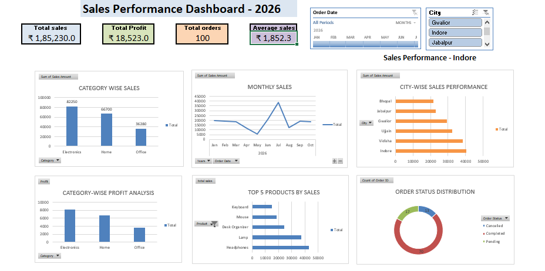

# 📊 Excel Sales Management & Analysis Project

## 📌 About the Project
This is my Excel-based Sales Management and Analysis project. I created this project to practice Excel skills and understand how sales data can be cleaned, organized, analyzed, and presented through an interactive dashboard.

The project uses a sample dataset of 100 sales records.

## 🛠️ Tools & Skills Used
- Microsoft Excel
- Data Cleaning
- VLOOKUP & HLOOKUP
- INDEX & MATCH
- IF, IFERROR, SUMIFS, COUNTIFS
- PivotTables & PivotCharts
- KPI Cards
- Slicers & Timeline
- Interactive Dashboard

## 📂 Project Contents
- **Dashboard:** Interactive sales dashboard with KPI cards and charts.
- **Raw Data:** Original sales dataset.
- **Cleaned Data:** Organized and cleaned dataset.
- **Summary:** Sales summary and analysis.
- **Product Master:** Product-related information.
- **Formula Practice:** Excel lookup and formula practice.
- **Skills Guide:** Skills and formulas used in the project.

## 📈 Dashboard Features
- Total Sales
- Total Profit
- Total Orders
- Average Sales
- City-wise Sales Analysis
- Category-wise Sales Analysis
- Monthly Sales Analysis
- Interactive City Slicer and Date Timeline
  ## 📸 Project Dashboard

## 🎯 What I Learned
Through this project, I practiced data cleaning, Excel formulas, PivotTables, data analysis, and dashboard creation. I also learned how to make reports interactive using Slicers and Timeline.

## 📁 Project File
[📥 Download Excel Workbook](Excel_Sales_Management_Portfolio_Final.xlsx)

## 🙌 Conclusion
This is one of my practical Excel projects, created to improve my data analysis skills and build my portfolio.

